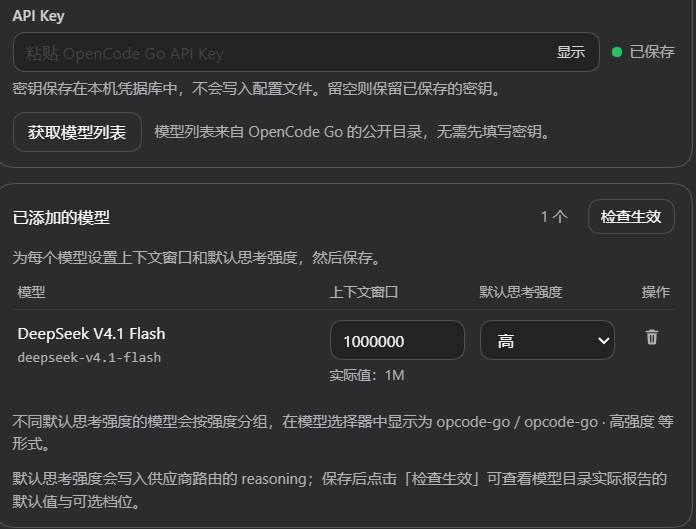

# dsh-plugin-opencode-go-models

一个 DeepSeek Harness（DSH）设置页插件，用来管理 **OpenCode Go** 的模型列表。

它把 OpenCode Go 的模型以独立的 `opcode-go` 供应商接入 DSH：填一次 API Key，拉取可用模型，选择需要的模型，设置上下文窗口和默认思考强度，保存后即可在对话的模型选择器中使用。

> 本项目是第三方开源插件，与 OpenCode 官方无任何关联或背书。详见 [免责声明](#免责声明)。



## 功能

- **不用手动改配置文件**：在设置页里完成 API Key、模型列表、上下文窗口和思考强度的管理。
- **不覆盖原生供应商**：插件写入独立的 `opcode-go` 供应商，DSH 原生的 `opencode-go` 配置不会被改写。
- **每个模型独立设置**：同一个供应商下，不同模型可以有不同的上下文窗口和默认思考强度。
- **选择器里不混淆**：插件模型显示为 `opcode-go`，原生模型仍显示为 `opencode-go`，两者分开。
- **随时可回退**：删除 `opcode-go` 里的全部模型即可移除插件供应商，原生配置不受影响。

## 快速使用

1. 打开 **设置 → opencode-go**。
2. 在「连接」卡片中确认供应商地址（页面会自动带出），粘贴 OpenCode Go 的 API Key。已保存的 Key 会显示绿色圆点。
3. 点击 **获取模型列表**，页面会读取 OpenCode Go 当前可用的模型。
4. 在「可用模型」中搜索并点击 **添加**，把需要的模型加入下方列表。
5. 在「已添加的模型」中设置 **上下文窗口** 和 **默认思考强度**。
6. 点击 **保存并应用**。
7. 打开对话输入框的模型选择器，选择 `opcode-go` 分组下的模型。

## 页面说明

### 连接

- **供应商地址**：页面自动带出的 OpenCode Go 兼容地址，可一键复制。
- **API Key**：只保存在本机凭据库，不写入配置文件。输入框留空表示保留已保存的 Key；填入新 Key 并保存会覆盖旧 Key。
- **获取模型列表**：从 OpenCode Go 的公开模型目录读取，不需要先填写 Key。

### 已添加的模型

| 区域 | 说明 |
|---|---|
| 模型 | 显示模型名称和实际请求 ID |
| 上下文窗口 | 默认按模型实际能力填写，可手动调整；不建议超过模型真实上限 |
| 默认思考强度 | 只列出该模型支持的档位；保存后作为之后选择该模型时的默认值 |
| 检查生效 | 读取实时模型目录，显示模型实际报告的默认强度和可选档位 |
| 保存并应用 | 将当前列表写入 `opcode-go` 供应商，立即生效 |

### 模型选择器中的表现

- 插件添加的模型显示为 **`opcode-go`**，原生 OpenCode Go 模型显示为 **`opencode-go`**，两者不会混在一起。
- 如果不同模型选择了不同的默认思考强度，插件会按强度分组，例如：
  - `opcode-go`
  - `opcode-go · High`
  - `opcode-go · Max`

  页面仍然是一张统一的表；选择器里按组显示。
- 每个模型仍会保留它实际支持的思考档位，因此在对话里切换强度不会越界。

## 安装

### 从本仓库安装

```sh
git clone https://github.com/CL-wel/dsh-plugin-opencode-go-models.git
```

克隆后在 DSH 的插件管理里安装这个目录，或在插件管理中选择本地目录指向它。

安装后重启 DSH，打开 **设置 → opencode-go**。

### 从 npm 安装（发布后）

```sh
npm install dsh-plugin-opencode-go-models
```

然后同样在 DSH 的插件管理里启用它。

## 兼容性

- 需要 DSH 自带 `llm-pi-ai` 适配器（默认组合即包含）。
- 页面使用 DSH 的 `settings.section` 插槽和主题变量，跟随 DSH 的明暗主题。
- 模型目录来自 OpenCode Go 的公开接口，无需先填 Key 即可浏览。

## 常见问题

**为什么有两个供应商？**
`opencode-go` 是 DSH 原生的 OpenCode Go 供应商；`opcode-go` 是本插件管理的独立供应商，用来避免插件配置覆盖原生配置。

**为什么选择器里有多个 `opcode-go` 分组？**
DSH 的默认思考强度是供应商级的。插件把相同默认强度的模型放在同一组，不同强度拆成 `opcode-go · High`、`opcode-go · Max` 等；所有模型仍在同一张表里管理。

**怎么删除模型？**
在「已添加的模型」表格右侧点击垃圾桶图标，然后保存。全部删除后 `opcode-go` 会从模型选择器中消失，原生 `opencode-go` 不受影响。

**怎么确认思考强度真的生效？**
保存后点击「检查生效」。页面会显示模型目录实际报告的默认强度和可选档位；如果当前会话里手动选过别的强度，会以会话选择为准，页面里的默认值用于之后选择该模型时。

**换 API Key 会影响原生吗？**
插件和原生 OpenCode Go 共用同一个 Key 引用。在插件页面换 Key 会同时影响两者；如果只想改插件，请在原生配置里使用不同的 Key 引用。

**插件会影响原生 `opencode-go` 吗？**
不会。插件只写 `opcode-go` 及其分组路由，不改原生供应商的配置。

**插件会影响模型能力或 token 速度吗？**
插件不修改提示词、工具列表或消息内容，因此不改变模型本身的能力，也不额外消耗 token。它只补充连接所需的请求头，并按你的设置写入上下文窗口与默认思考强度。

**多个对话会共用同一个 session 吗？**
不会。插件在每次请求发出前，用当前对话的真实 Session ID 覆盖连接头；只有标题生成这类没有对话上下文的辅助请求，才使用进程内稳定的兜底 ID。因此每个对话的路由和缓存是独立的，和原生供应商的行为一致。

## 免责声明

- 本项目是**第三方、非官方**的 DSH 插件，与 OpenCode 及其关联方没有隶属、合作或背书关系。
- "OpenCode"、"OpenCode Go" 等名称及相关标识归其权利人所有。本项目对这些名称的使用仅用于**描述所连接的服务**，不代表任何官方授权。
- 本项目不包含或再分发 OpenCode 的官方代码、Logo 或品牌素材；图标为本项目原创。
- 使用本项目需要你自行持有有效的 OpenCode Go 订阅与 API Key，并遵守 OpenCode 的服务条款。
- 本项目按 MIT 许可证“按原样”提供，不提供任何明示或默示担保。

如权利人认为本项目的命名或使用方式不妥，请通过 issue 联系，我们会及时调整。

## 许可证

[MIT](LICENSE)
